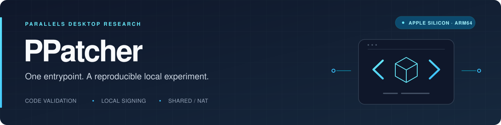
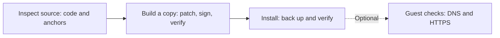
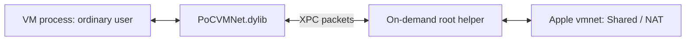

<p align="center">
  
</p>

<p align="center">
  <strong>A single-file toolkit for reproducing a local Parallels Desktop licensing and networking proof of concept.</strong>
</p>

<p align="center">
  
  
  
  
</p>

<p align="center">
  <a href="#overview">Overview</a> &nbsp;·&nbsp;
  <a href="#quick-start">Quick start</a> &nbsp;·&nbsp;
  <a href="#command-reference">Commands</a> &nbsp;·&nbsp;
  <a href="#verification-and-evidence">Evidence</a> &nbsp;·&nbsp;
  <a href="#documentation">Documentation</a>
</p>

---

## Overview

**PPatcher** packages the reviewed client, dispatcher, and VM changes into one self-contained Python entrypoint: [`parallels_onefile.py`](parallels_onefile.py). Given an operator-supplied original application bundle, it builds and signs a separate test copy, installs a restricted Shared/NAT networking helper, and can check DNS and HTTPS in an existing Windows guest.

The investigation targets **Parallels Desktop 27.0.3 (58680) on Apple silicon**. The repository contains source and research evidence prepared for vendor disclosure. No Parallels application, guest disk, certificate, private key, license, or account token is included.

> [!IMPORTANT]
> **Read the evidence as a bounded result.** On 17 October 2026, an earlier manually assembled build started a linked clone, reached the Windows desktop, and passed guest DNS and HTTPS checks while the host logged `PRL_ERR_LICENSE_NOT_VALID`. The current one-file builder was tested offline; its installer and SDK start path have **not been run end to end**. Full activation and every premium capability remain unverified. See [runtime verification](docs/runtime.md).

### At a glance

| Area | What PPatcher provides |
| --- | --- |
| Source validation | ARM64 Mach-O parsing, executable-section SHA256 checks, unique instruction anchors, and address-mapping checks |
| Separate build | A copied application bundle with the reviewed changes and local code signing; the source is never patched in place |
| Networking | An on-demand root helper and VM interposition library for Apple vmnet Shared/NAT over XPC |
| Installation | A fixed application target, timestamped backup, and attempted recovery if the privileged install step fails |
| Verification | Manifest-based file checks, strict recursive signature verification, and optional Windows guest network checks |
| Dependencies | Python standard library and macOS command-line tools; no third-party Python packages |

### Contents

- [Requirements](#requirements)
- [Quick start](#quick-start)
- [Staged workflow](#staged-workflow)
- [Command reference](#command-reference)
- [How it works](#how-it-works)
- [Build artifacts and installed files](#build-artifacts-and-installed-files)
- [Verification and evidence](#verification-and-evidence)
- [Compatibility and limitations](#compatibility-and-limitations)
- [Troubleshooting](#troubleshooting)
- [Backups and recovery](#backups-and-recovery)
- [Documentation](#documentation)

## Requirements

| Requirement | Details |
| --- | --- |
| Host | An **Apple silicon Mac**. The builder requires ARM64 macOS. |
| Source application | A separate, unmodified **Parallels Desktop 27.0.3 (58680)** bundle supplied by the operator. A different 27.x package is accepted only if its reviewed code sections, anchors, and layout checks still match. |
| Python | **Python 3.10 or newer**. |
| Build tools | **Xcode command-line tools**, including the compiler and macOS signing utilities. |
| Signing identity | A local **Apple Development** identity with a ten-character Team ID. Supply its SHA1 identifier; no private key is exported. |
| Install state | Shut down running VMs and quit the Parallels UI. Administrator authorization is required to replace the application and install the helper. |
| Guest checks, optional | An existing, registered **Windows VM** with **Parallels Tools** and a logged-in user. Configure it for **Shared Networking**. |

The script patches Parallels' **VM executable**. It does not create a Windows installation, register a new VM, or clone a guest disk.

## Quick start

Run these commands on the target Mac. Use a fresh output directory **outside the repository**, separate from the original source bundle.

### 1. Get the source

```sh
git clone https://github.com/SNO2207/PPatcher.git
cd PPatcher
```

### 2. Check the local prerequisites

```sh
python3 --version
xcode-select -p
security find-identity -v -p codesigning
```

If the Xcode command-line tools are missing, install them with `xcode-select --install`. From the signing-identity list, use the SHA1 identifier of your local Apple Development identity in place of `YOUR_CODESIGN_IDENTITY_SHA1` below.

### 3. Inspect the original application

```sh
python3 parallels_onefile.py inspect \
  --source-app '/path/to/original/Parallels Desktop.app'
```

`inspect` is read-only. It validates the three executable code sections and patch anchors and prints the inspection result as JSON. An already patched installation is not valid source input. The build also verifies the original bundle's code signature.

### 4. Build, install, and verify

Shut down the VMs and quit Parallels before continuing:

```sh
python3 parallels_onefile.py all \
  --source-app '/path/to/original/Parallels Desktop.app' \
  --output "$HOME/Parallels-PoC-Build" \
  --identity 'YOUR_CODESIGN_IDENTITY_SHA1'
```

This builds the separate signed bundle, prompts for administrator authorization during installation, and verifies the installed files. Guests remain stopped unless you add `--vm-name`. To also start and check an **existing registered Windows guest**, use:

```sh
python3 parallels_onefile.py all \
  --source-app '/path/to/original/Parallels Desktop.app' \
  --output "$HOME/Parallels-PoC-Build" \
  --identity 'YOUR_CODESIGN_IDENTITY_SHA1' \
  --vm-name 'Premium Linked Clone PoC'
```

Choose **one** of these `all` invocations; rerunning a build requires a fresh output directory. Replace the example VM name with your guest's registered name. The check leaves the guest running; use **Parallels → Actions → Shut Down** when finished.

> [!NOTE]
> Build and installation checks establish file and signature consistency. Guest network access is a separate check, and neither result establishes complete product activation.

## Staged workflow

Use separate commands to review the build before installation. Use the same output directory throughout this workflow, starting with a directory that does not exist yet.

**Build and check the staged bundle:**

```sh
python3 parallels_onefile.py build \
  --source-app '/path/to/original/Parallels Desktop.app' \
  --output "$HOME/Parallels-PoC-Build" \
  --identity 'YOUR_CODESIGN_IDENTITY_SHA1'

python3 parallels_onefile.py verify-build \
  --output "$HOME/Parallels-PoC-Build"
```

**Install and check the installed files:**

```sh
python3 parallels_onefile.py install \
  --output "$HOME/Parallels-PoC-Build"

python3 parallels_onefile.py verify-installed \
  --output "$HOME/Parallels-PoC-Build"
```

`install` also runs the installed-file verification automatically. The separate `verify-installed` command lets you repeat that check later.

**Optionally start and check the Windows guest:**

```sh
python3 parallels_onefile.py verify-guest \
  --vm-name 'Premium Linked Clone PoC' \
  --start
```

Omit `--start` when the guest is already running. The command uses the installed local SDK to run fixed `nslookup.exe` and `curl.exe` checks as the logged-in Windows user. It prints guest output and a JSON result without requesting or storing a guest password.

## Command reference

| Command | Required arguments | Action |
| --- | --- | --- |
| `inspect` | `--source-app` | Read and validate the original application; print source hashes and matching anchors. |
| `build` | `--source-app`, `--output`, `--identity` | Create and sign a separate build in a new directory. |
| `verify-build` | `--output` | Verify the staged bundle signature and manifest hashes. |
| `install` | `--output` | Install the verified build and helper, then verify the installed files. |
| `verify-installed` | `--output` | Compare the installed app, helper, shim, and launchd plist with the build; check signing metadata and helper ownership. |
| `verify-guest` | `--vm-name` | Run guest DNS and HTTPS checks; add `--start` to start the VM first. |
| `all` | `--source-app`, `--output`, `--identity` | Build, install, and verify; add `--vm-name` to start a guest and check its network access. |

`build` and `all` also accept `--uid`. It defaults to the invoking user's UID and configures which local user the network helper admits. The builder requires a non-root account UID from **500 through 65534**. Run it as the intended ordinary user and let the installer request administrator authorization.

For built-in help:

```sh
python3 parallels_onefile.py --help
python3 parallels_onefile.py build --help
```

## How it works



### Validate before writing

Each thin ARM64 Mach-O must match the reviewed executable `__TEXT.__text` SHA256. Every patch site must have a unique **16-byte context before and after** the original instructions and the expected address mapping. The script also checks the dispatcher's Team ID context and the empty executable spaces used by the VM peer helper and client message filter.

A changed executable section, absent or ambiguous anchor, occupied code cave, or insufficient load-command padding stops the build. Matching a version label alone is insufficient.

### Apply the reviewed changes and sign locally

The build reproduces **seven client, two dispatcher, and three VM instruction changes**, plus signing-identity adjustments and a VM library-load command. A client constructor change bypasses registration of the local counterfeit-warning timer; the earlier `-11079` message filter remains as a fallback. It replaces the dispatcher's expected Team ID with the local signing Team ID. After signing the dispatcher, it derives the actual CDHash for the VM peer-check helper while retaining the original dispatcher identifier check. See the [counterfeit-warning analysis](docs/counterfeit-warning.md) for the runtime call stack and exact patch site.

The dispatcher is signed ad hoc with its original smartcard entitlement. The VM and interposition library use the local development identity; the outer app is signed ad hoc with the launchable client entitlement set. The staged application must pass `codesign --verify --deep --strict`.

### Keep privileged networking in a separate helper



The embedded C helper owns the privileged vmnet interface. The VM library forwards interface operations and packets over XPC while the VM remains an ordinary-user process. The helper checks the connecting user's UID and the locally signed VM identity.

The helper, shim, and broker header are compressed source text inside the Python entrypoint. Their embedded SHA256 values are verified before compilation. See the [networking investigation](docs/networking/README.md) for the architecture and historical tests.

### Install a verified copy

Installation stages the build through `/private/tmp`, retains the previous application, and runs the unmodified vendor initializer to restore helper ownership and permissions. It installs the root helper and launchd service, then checks the installed signature and files. The application target is fixed at `/Applications/Parallels Desktop.app`.

## Build artifacts and installed files

```text
Parallels-PoC-Build/
├── Parallels Desktop.app/
├── manifest.json
├── build-sources/
│   ├── broker.h
│   ├── helper.c
│   └── shim.c
├── PoCVMNet.dylib
├── local.codex.parallels-poc.vmnet
├── local.codex.parallels-poc.vmnet.plist
├── client-entitlements.plist
├── service-entitlements.plist
└── vm-entitlements.plist
```

`manifest.json` records the tool version, source inspection, per-binary changes, output hashes, local Team ID, helper UID, and dispatcher CDHash. Keep the output directory for subsequent verification. It contains a patched vendor application and must remain local; the [`.gitignore`](.gitignore) excludes common build products and signing material.

<details>
<summary><strong>Installed paths</strong></summary>

| Component | Location |
| --- | --- |
| Application | `/Applications/Parallels Desktop.app` |
| Root helper | `/Library/PrivilegedHelperTools/local.codex.parallels-poc.vmnet` |
| launchd service | `/Library/LaunchDaemons/local.codex.parallels-poc.vmnet.plist` |
| Helper log | `/var/log/local.codex.parallels-poc.vmnet.log` |
| VM library | `/Applications/Parallels Desktop.app/Contents/MacOS/Parallels VM.app/Contents/Frameworks/PoCVMNet.dylib` |
| Previous application | `/Applications/Parallels Desktop.poc-backup-YYYYMMDD-HHMMSS.app` |

</details>

## Verification and evidence

The recorded runtime experiment took place on **17 October 2026**, using **Parallels Desktop 27.0.3 (58680)** on one Apple silicon host.

| Observation | Recorded result |
| --- | --- |
| Linked clone | Creation completed; the guest later booted to the Windows 11 desktop. |
| Host license state | The client and dispatcher logged `PRL_ERR_LICENSE_NOT_VALID` during launch. |
| Process privileges | The VM ran as ordinary-user UID 501; the packet helper ran as root. |
| Shared/NAT interface | Windows received `192.168.2.2/24` through gateway `192.168.2.1`. |
| DNS | `example.com` resolved successfully. |
| HTTPS | Both `example.com` and Apple's connectivity endpoint returned **HTTP 200**, **TLS verification result 0**, and **guest exit code 0**. |
| Helper access control | The signed VM was admitted; an unrelated ad hoc signed diagnostic client was rejected. |
| Installed integrity | The app passed recursive strict signature verification; original sections matched the preceding patched build after networking was added. |

These observations belong to the **earlier manually assembled build**. The one-file builder's offline test used original executable copies; its new installer and SDK start sequence have not been validated together on a running host.

Start with the [runtime report](docs/runtime.md), then inspect the [machine-readable network result](docs/networking/runtime_success.json), [captured guest output](docs/networking/guest-network-check.txt), and [patch-preservation comparison](docs/networking/patch-preservation.json).

## Compatibility and limitations

- **Reviewed code only.** A repackaged or re-signed 27.x bundle may pass if its executable sections and all structural checks still match. Changed code requires a fresh IDA review and new tests. The tool does not infer equivalent licensing behavior from similar patterns; the VM peer helper also contains relative ARM64 calls tied to this layout.
- **Shared/NAT only.** Keep the test VM configured for Shared Networking. Bridged networking, host-only networking, and port forwarding are outside this implementation.
- **Activation remains unverified.** Guest boot and networking do not establish full activation, every premium capability, clipboard transfer, or all CPU/RAM resource-limit paths.
- **Limited runtime coverage.** Throughput, long-duration stability, multiple concurrent VMs, and host-reboot behavior were not tested.
- **Linked-clone dependencies.** Keep the parent VM and the snapshot on which the clone depends.

## Troubleshooting

| Message or symptom | What to check |
| --- | --- |
| `Requires ARM64 macOS` | Run the builder on an Apple silicon Mac using native ARM64 Python. |
| `Output already exists` | Choose a fresh directory; `build` does not reuse or overwrite an existing one. |
| `executable code changed` or anchor/address errors | Confirm that the source is an unmodified matching build. A different code layout needs a new review. |
| Source signature verification fails | Use a separate, intact original bundle; the installed patched copy is not valid input. |
| `Signing identity has no usable Team ID` | Select a local Apple Development identity with a ten-character Team ID using `security find-identity -v -p codesigning`. |
| `Shut down the VM before installation` / `Quit Parallels before installation` | Shut down the guests and fully quit the Parallels UI, then retry installation. |
| `staged hash differs from manifest` or `Installed files differ` | Preserve the error output and compare against the build artifacts. Rebuild from clean source into a fresh directory if files were changed. |
| `Installed SDK 11 library not found` | Guest checks require the SDK library inside the installed application at the expected path. |
| Guest SDK or network check fails | Check the VM name, running state, Parallels Tools, logged-in Windows session, and Shared Networking configuration. Inspect the helper log listed above. |

## Backups and recovery

The installer retains the previous application as:

```text
/Applications/Parallels Desktop.poc-backup-YYYYMMDD-HHMMSS.app
```

If the privileged install step fails, it **attempts** to restore that application and the previous network helper/service. A later `verify-installed` or guest-check failure does not automatically trigger that restore.

There is currently **no `restore` or `uninstall` subcommand** in the one-file CLI. Keep the retained app, original source, and manifest. The backup reflects whatever was installed before this run, which may itself be a patched build. Manual recovery requires shutting down VMs, quitting Parallels, restoring the intended application, and accounting for the helper and launchd service listed above.

## Documentation

| Document | What it covers |
| --- | --- |
| [Runtime verification](docs/runtime.md) | Guest behavior and the boundary between the historical runtime test and the one-file builder |
| [Licensing analysis](docs/licensing-analysis.md) | Account authentication, signed entitlements, local license evaluation, and VM-start enforcement |
| [Licensing evidence](docs/Parallels_Licensing_Evidence.md) | Selected decompiler excerpts and original-code evidence |
| [Edition checks](docs/edition-checks.md) | Feature membership, client gates, service checks, and CPU/RAM limits |
| [Edition-check evidence](docs/Parallels_Edition_Checks_Evidence.md) | Locations and supporting excerpts for the reviewed edition checks |
| [Counterfeit warning](docs/counterfeit-warning.md) | Runtime producer, integrity timer, upstream patch, and verification |
| [Networking investigation](docs/networking/README.md) | Root helper, XPC packet proxy, signing restrictions, tests, and limitations |
| [Research history](docs/research-history.md) | Earlier profiles, failed attempts, and the sequence of follow-on experiments |

Historical documents refer to earlier scripts and local workspace artifacts that are not all included here. Use [`parallels_onefile.py`](parallels_onefile.py) and this README for the current entrypoint.

---

<p align="center">
  <sub>PPatcher · Parallels Desktop research proof of concept · Source and evidence for vendor disclosure</sub>
</p>
