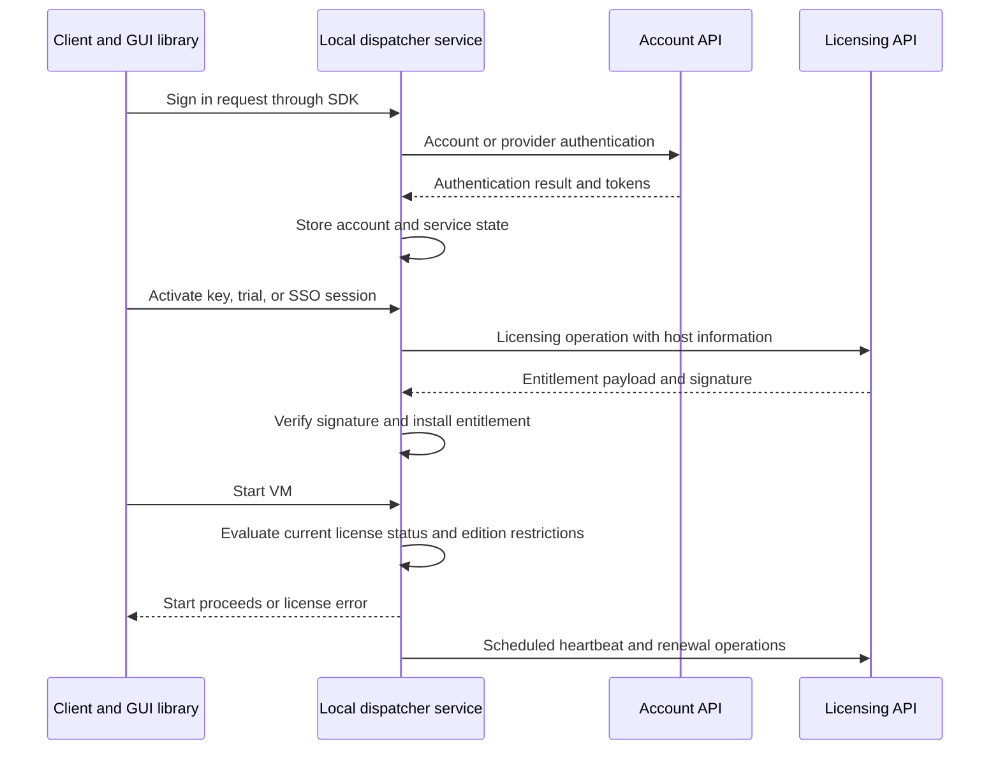

# Parallels Desktop licensing and authentication analysis

Parallels Desktop separates account authentication from license authorization. Signing in obtains account and service tokens. Activation obtains a signed JSON entitlement, which the local dispatcher service verifies, stores, and evaluates. VM startup consults that service’s license status. A successful account login alone therefore does not establish permission to run a VM.

This analysis covers the installed **Parallels Desktop 27.0.3 build 58680**, specifically its ARM64 code. It is based on static disassembly, cross references, and Hex Rays decompilation through the Official IDA MCP Server on October 17, 2026. Network exchanges and server internals were not exercised. The distinction matters: the binary establishes client behavior and accepted data structures, while the server’s credential storage, issuance policy, and revocation decisions remain outside this evidence.

## Binaries and reproducibility

The application bundle identifies `prl_client_app` as its main executable. Much of the relevant work lives in its GUI library and local service.

| Component | Role in the reviewed flow | SHA256 |
| --- | --- | --- |
| `prl_client_app` | License UI, task orchestration, SDK calls | `8aafd57766594be4120607f69e795966cd5615f02d0cd79563e05b57ef49527f` |
| `prl_disp_service` | Account requests, activation, stored entitlement verification, VM startup enforcement | `d9f2fff825b4e97400bfffb110b96b242d246d93aa3f4da05308f3e4319d6c26` |
| `libPrlGui.3.dylib` | Sign in tasks, social authentication, OAuth callback, cached social tokens | `dbb60747b2d793214af2096b392dfa08bd11758cf9a76092187acf3823929e45` |

The first two executables use IDA image base `0x100000000`. Library addresses below refer to the ARM64 slice with image base zero; the library hash identifies the complete universal file. Addresses are virtual addresses, not file offsets. ASLR changes runtime addresses.

The [evidence appendix](Parallels_Licensing_Evidence.md) contains selected decompiler excerpts, resolved parameter names, and cryptographic constants. Function descriptions assigned to stripped `sub_...` routines below are analytical labels. C++ argument types and hidden return parameters are sometimes reconstructed incorrectly by the decompiler; decisive API routing was checked against ARM64 instructions.

## Overall flow



This is a reconstruction of the reviewed paths. Business, trial, offline, and social sign in branches enter at different points.

## Account authentication

### The GUI hands authentication to the service

`CSignInDelegate::signInRequest` in the GUI library at `0xE4170` creates a dispatcher web request task. Its implementation at `0xE8BDC` selects among email/password, Facebook, Google, and Apple variants, packs the relevant values, and calls `PrlSrv_StoreValueByKey`. `CSdkCommunicator::createRequest` then tracks the asynchronous operation. The UUID shaped operation identifiers in this routine are command selectors; their appearance does not make them authentication secrets. ([G1](Parallels_Licensing_Evidence.md#g1-gui-sign-in-handoff))

The main client imports `CTaskSignIn`, `CTaskSignInWithSocialAccount`, `PrlSrv_GetLicenseInfo`, and `PrlSrv_UpdateLicenseEx`. Its license wrapper at `0x10041DEA8` reads license status and key fields from an SDK handle returned by the dispatcher. This places substantive account and license processing across a process boundary.

### Email and password authentication

The service request builder at `0x1003FEF54` has a direct authentication branch that constructs an `auth` request with `email` and `password` parameters. It converts the password to UTF8, calls `QCryptographicHash::hash` with algorithm value `1`, and hex encodes the result before placing it in the password field. Qt defines algorithm `1` as MD5. The same pattern appears in the GUI library’s common web request implementation at `0x1E08FC`. ([S1](Parallels_Licensing_Evidence.md#s1-account-request-builder), [S27](Parallels_Licensing_Evidence.md#s27-verified-constants) ; Qt reference below)

Conceptually, this branch sends:

```text
account auth request
    email = supplied email
    password = hex(MD5(UTF8(supplied password)))
```

The API base is constructed with HTTPS. The MD5 value is a transformed credential inside that transport; hashing alone does not establish resistance to replay. This code also does not reveal whether the server stores that value directly, hashes it again, or performs other account checks.

On a successful sign in result, `0x10015CC20` clears previous token state, retrieves two token values from the completed authentication object, and stores them through a QSettings backed helper at `0x1001500C8`. Failure takes a separate reset path. Stored token keys are initialized as UUID shaped strings. These settings identifiers should not be confused with the token values themselves. ([S2](Parallels_Licensing_Evidence.md#s2-successful-sign-in-persists-tokens))

A service token request at `0x10016028C` uses the command `gen_auth_token`, an `AuthorizationToken` field, and service selectors including `lic` and `self`. This supplies direct evidence of a token layer between account authentication and subsequent service access. ([S26](Parallels_Licensing_Evidence.md#s26-service-token-request), [S27](Parallels_Licensing_Evidence.md#s27-verified-constants))

### Social authentication and Google OAuth

`CTaskSignInWithSocialAccount::getSocialAccountCreds` at library address `0xF46D4` selects dedicated Facebook, Google, and Apple login tasks. Provider credentials are subsequently passed into the sign in task. Apple paths include native Authentication Services and browser related implementations; this analysis traces Google in more detail. ([G8](Parallels_Licensing_Evidence.md#g8-social-sign-in-variants))

The Google path behaves as follows:

1. `CTaskGoogleLogin::getAuthCode` at `0xEFC64` starts a local callback listener and constructs an authorization URL at Google’s OAuth endpoint. Parameters include `client_id`, a loopback redirect shaped as `http://127.0.0.1:<port>/`, `response_type=code`, scope `openid profile email`, and `state`.
2. `onGetAuthCodeFinished` at `0xF0344` closes the listener, extracts `code` and `state`, compares the returned state with the saved value, and requires a nonempty authorization code before reporting success.
3. `getAuthToken` at `0xF06A4` exchanges the authorization code at Google’s token endpoint. `onGetAuthTokenFinished` at `0xF0BCC` extracts `access_token`; a subsequent task obtains user information.

The callback state comparison is confirmed code behavior. The reviewed authorization URL builder does not show PKCE parameters, but that observation alone is not a demonstrated attack. ([G2](Parallels_Licensing_Evidence.md#g2-google-authorization-url), [G3](Parallels_Licensing_Evidence.md#g3-google-callback-state-check), [G4](Parallels_Licensing_Evidence.md#g4-google-token-exchange))

The GUI caches Facebook and Google tokens under `Register/FacebookToken` and `Register/GoogleToken`. `saveToken` at `0xE3FC8` transforms the token with wrapper `0x1590D8` and writes it to QSettings; `loadToken` at `0xE3DC0` reads and reverses the transformation with `0x1595C0`. The wrapper uses CommonCrypto algorithm `6`, mode `3`, and a fixed IV string: Blowfish in CFB mode. Its key comes from another helper, whose protection was not established here. This is application managed token storage; these functions do not establish Keychain protection for these cached social tokens. [G5–G7; Apple reference below]

## Activation and licensing requests

### Legacy licensing operations

The service payload builder at `0x100152AB8` selects commands through a table at `0x1006BD168`. The recovered mapping includes:

| Operation | Command |
| --- | --- |
| Heartbeat | `licensing/heartbeat` |
| Deactivation | `licensing/deactivate` |
| Key activation | `licensing/activate` |
| Trial acquisition | `licensing/get_trial` |
| SSO activation | `licensing/sso_activate` |

The builder selects location `6`, which the API base routine at `0x1003F4558` maps to `https://desktop.<domain>/dispatcher_api/v1`. Account location `0` maps to `https://desktop.<domain>/account/api/v1`. The domain is configurable; these are recovered templates, not observed destinations from a packet capture. ([S3](Parallels_Licensing_Evidence.md#s3-license-command-payloads), [S17](Parallels_Licensing_Evidence.md#s17-api-base-construction), [S27](Parallels_Licensing_Evidence.md#s27-verified-constants))

Depending on the selected operation, request fields include `host`, `hw_id`, `lic_key`, `prev_lic_key`, `lic_edition`, `dry_run`, `force`, `token`, `session_id`, `deactivate_hw_id`, and `vendor_info`. They are branch specific, rather than one payload sent on every operation. Trial and SSO therefore have their own request shapes instead of being ordinary key entry with a different UI label. ([S3](Parallels_Licensing_Evidence.md#s3-license-command-payloads))

Host metadata construction at `0x10014B870` includes hardware ID, OS name and architecture, product build, hostname, serial number, user name, and network address fields. The function also contains redaction and field length handling. Its presence proves these fields can be assembled for licensing requests; it does not prove every field is transmitted under every configuration.

### Host authentication through PrlHostBearer

A separate host API request path at `0x100293AC0` selects location `11`. The same base builder maps this to `https://desktop.<domain>/license/api/v1`. Reviewed callers include host information updates using `hosts/<id>`. This is distinct from the legacy dispatcher command path. ([S14](Parallels_Licensing_Evidence.md#s14-host-api-headers), [S15](Parallels_Licensing_Evidence.md#s15-host-jwt), [S16](Parallels_Licensing_Evidence.md#s16-hmac-encoding), [S17](Parallels_Licensing_Evidence.md#s17-api-base-construction), [S27](Parallels_Licensing_Evidence.md#s27-verified-constants))

Its header builder at `0x100293C18` adds:

```text
x-HostId: <host identifier>
x-InstanceID: <instance identifier>
Authorization: PrlHostBearer <JWT>
```

`0x100294044` constructs the JWT with `typ=JWT` and `alg=HS256`. It sets `iss` from the instance identifier used by the request object, obtains a subject identifier through a configuration helper, and sets `exp` to the current Unix time plus **60 seconds**. `0x1003F34C0` serializes and base64url encodes the header and payload, then computes HMAC using Qt hash algorithm `4`, which is SHA256. The signing key comes from request object state. Its provisioning was not established in this trace. ([S15](Parallels_Licensing_Evidence.md#s15-host-jwt), [S16](Parallels_Licensing_Evidence.md#s16-hmac-encoding))

This JWT authenticates a host API request. It is a different object and uses a different cryptographic mechanism from the signed license entitlement described next.

## License verification and local authorization

### Signed JSON is the entitlement

The central acceptance routine is `0x100279B54` in the service. Its order is significant:

1. Verify the payload and detached signature through `0x1004626AC`.
2. Parse the payload into a JSON object through `0x1003190C8`.
3. Apply caller selected policy checks, including an offline flag requirement for offline installation.
4. Persist the `license` and `signature` fields when installation requests persistence.
5. Update the in memory license object.

Signature failure exits with the diagnostic `Signature check failed for license info`. Parsing and persistence have separate error paths. An online result application routine at `0x100155CD0` calls this same acceptance routine and propagates an error if acceptance fails. ([S4](Parallels_Licensing_Evidence.md#s4-license-acceptance))

The verifier at `0x1004626AC` converts the payload string to UTF8, decodes the detached signature from Base64, and passes it to a custom RSA verification implementation. The arithmetic operates on a **2048 bit embedded modulus**. The exponentiation routine at `0x100462A00` uses exponent **65537**. The comparison in `0x10046245C` checks PKCS1 v1.5 padding, a SHA256 DigestInfo marker, and a digest computed from the payload. SHA256 initial constants and the DigestInfo bytes were checked directly in the database. This identifies the reviewed mechanism as **RSA2048 with PKCS1 v1.5 and SHA256**. ([S12](Parallels_Licensing_Evidence.md#s12-rsa-verification), [S13](Parallels_Licensing_Evidence.md#s13-rsa-exponentiation), [S27](Parallels_Licensing_Evidence.md#s27-verified-constants))

The embedded value is a public verification key. The licensing server’s private signing key was not present in this verification path.

### Persistence and reload

The default license file path is `/Library/Preferences/Parallels/licenses.json`. The directory builder at `0x1005130F4` also supports `PARALLELS_CONFIG_DIR`; `0x100513620` appends the filename. The backing file holds `license` and `signature` fields, with additional handling for `publicCerts`. ([S24](Parallels_Licensing_Evidence.md#s24-license-path), [S25](Parallels_Licensing_Evidence.md#s25-config-directory), [S27](Parallels_Licensing_Evidence.md#s27-verified-constants))

The loader at `0x100279F58` reads the saved pair and calls `0x100279B54` again. Persisted data is therefore reverified when loaded. File writing uses a mutex guarded helper, checks write length, and flushes the file. File access errors are separate from cryptographic validity errors. ([S4](Parallels_Licensing_Evidence.md#s4-license-acceptance), [S5](Parallels_Licensing_Evidence.md#s5-stored-license-reload))

### Hardware, version, and time checks

After installation, the service evaluates the parsed entitlement through status getter `0x100279B3C` and validator `0x10031A878`.

| Check | Observed behavior |
| --- | --- |
| Present entitlement | Empty JSON produces an invalid license result. |
| Disabled state | The outer getter can return a disabled status before evaluating JSON policy. |
| Hardware binding | For a nonoffline entitlement, `0x100319F8C` searches `hosts` entries for a matching `hw_id`. |
| Product version | `product_version` is parsed and compared with major version 27, with additional trial and future version logic. |
| Beta compatibility | The `is_beta` field participates in release compatibility checks. |
| Platform | The `platform` field is checked against accepted values. |
| Expiry | `0x10002D8C8` compares the effective license end time with the current time. |

The effective end time uses `grace_period_ends_at` when available and otherwise `main_period_ends_at`. Trial handling also adjusts date/time interpretation. The values come from entitlement data; the binary does not establish a single fixed grace period shared by all license classes. ([S7](Parallels_Licensing_Evidence.md#s7-license-status), [S8](Parallels_Licensing_Evidence.md#s8-hardware-binding), [S9](Parallels_Licensing_Evidence.md#s9-expiry), [S10](Parallels_Licensing_Evidence.md#s10-main-expiry-field), [S11](Parallels_Licensing_Evidence.md#s11-grace-expiry-field))

An offline entitlement takes a different hardware policy branch, but the offline flag is inside the signed entitlement and offline import still goes through signature verification. It is not an unsigned local setting. ([S4](Parallels_Licensing_Evidence.md#s4-license-acceptance), [S6](Parallels_Licensing_Evidence.md#s6-offline-activation), [S7](Parallels_Licensing_Evidence.md#s7-license-status))

### Offline activation

The offline import routine at `0x10020C760` parses an outer JSON object, extracts `subscription` and `signature`, requires both strings, and invokes the common acceptance routine in offline installation mode. That mode requires the signed payload’s `offline` property. The outer import field is called `subscription`; the persistent store calls its payload field `license`. ([S6](Parallels_Licensing_Evidence.md#s6-offline-activation))

Conceptually, offline activation transports a server authorized payload and its detached signature to the service without requiring the import operation itself to obtain a new online response.

## Heartbeats and license lifecycle

Heartbeat state tracks the last successful heartbeat, the last attempted heartbeat, and the last prolongation attempt. `0x100158C28` always records an attempt and records the successful heartbeat timestamp only on a successful result. ([S19](Parallels_Licensing_Evidence.md#s19-heartbeat-state-machine), [S22](Parallels_Licensing_Evidence.md#s22-heartbeat-result))

The scheduler includes these thresholds:

| Value | Where it appears | Interpretation supported by the code |
| --- | --- | --- |
| 60 seconds | `0x1001580A0` | Timer wakeup used to reconsider scheduled work. |
| 604800 seconds | `0x100158884` | Seven day threshold relative to the previous heartbeat. |
| 86400 seconds | `0x100158884` | Daily throttling of further attempts once a heartbeat is due. |
| 86400 seconds | `0x100158728` | Daily throttling in the separate prolongation scheduling path. |

These values describe scheduling logic. They do **not** establish that every license permits seven days offline, that a request is sent every minute, or that connectivity failure immediately revokes an otherwise valid entitlement. The state machine also considers entitlement state, dates, previous attempts, and force flags. ([S19](Parallels_Licensing_Evidence.md#s19-heartbeat-state-machine), [S20](Parallels_Licensing_Evidence.md#s20-heartbeat-scheduling), [S21](Parallels_Licensing_Evidence.md#s21-renewal-scheduling), [S22](Parallels_Licensing_Evidence.md#s22-heartbeat-result))

The service has explicit deactivation and sign out operations. Offline sign out at `0x10014F32C` cleans token state, public key related data, and license data, and rejects overlapping license operations. Thus account state and license state are related in lifecycle operations even though they remain distinct checks. ([S23](Parallels_Licensing_Evidence.md#s23-offline-sign-out))

## Where enforcement happens

VM startup handling at `0x100057CA4` retrieves the service’s license status. A nonzero status enters a failure path that logs `Failed to start VM ... license status ...`; zero continues the normal startup path. The same routine also checks edition restrictions for x86 emulation and identifies that feature as limited to Professional and Business licenses. ([S18](Parallels_Licensing_Evidence.md#s18-vm-startup-gate))

Other service diagnostics identify CPU and memory limits and unsupported guest OS restrictions. Those diagnostics support the existence of additional entitlement consumers; their full enforcement paths were not traced here.

The resulting trust model is:

- The account service establishes identity and token access.
- The licensing service issues signed entitlement data and handles activation lifecycle requests.
- The local dispatcher verifies entitlement authenticity and evaluates local eligibility.
- The VM startup path consumes that evaluated status.

## Security interpretation and limits

The strongest confirmed separation is between a token that authenticates a request and a signed entitlement that authorizes product use. A successful sign in does not substitute for signature verification, hardware eligibility, expiry checks, or the VM startup gate.

The direct login branch uses an MD5 password transformation, and the GUI uses Blowfish CFB with a fixed IV for cached Facebook and Google tokens. These are concrete implementation observations that merit attention when assessing credential handling. They do not establish server side password storage, the complete protection of cached token keys, or a working credential attack.

This static analysis does not establish TLS certificate pinning, current backend acceptance rules, account token lifetimes, host JWT key provisioning, or revocation timing across all editions. Exact runtime request bodies and persistence contents would require a separate controlled dynamic trace. No activation request, credential submission, token extraction from user storage, binary patch, or configuration change was performed.

## Evidence and external references

Bracket labels such as S4 and G3 refer to sections in the [binary evidence appendix](Parallels_Licensing_Evidence.md). Most findings derive directly from the three identified binaries. The following primary references were used only to resolve library algorithm constants:

- [Qt 5 QCryptographicHash algorithm values](https://doc.qt.io/archives/qt-5.15/qcryptographichash.html): MD5 is `1`; SHA256 is `4`.
- [Apple CommonCrypto CommonCryptor header](https://github.com/apple-oss-distributions/CommonCrypto/blob/main/include/CommonCryptor.h): Blowfish is algorithm `6`; CFB is mode `3`.
